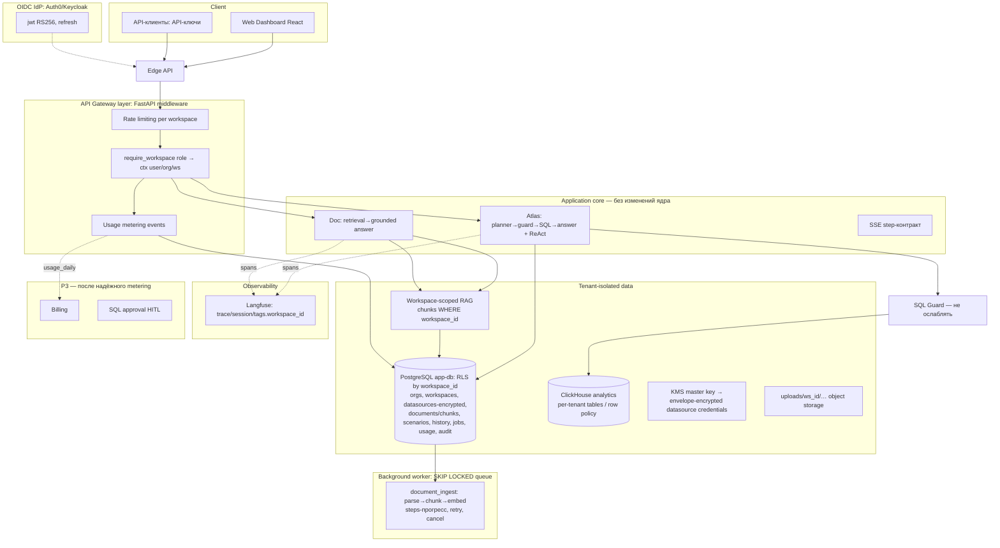

# SAAS ARCHITECTURE — целевая архитектура и roadmap (Stage 6)

Основа: ARCHITECTURE_AUDIT.md (подтверждённые пробелы G1–G9) + ADR-002…006.
Принцип: агенты (Atlas/Doc), SQL Guard, SSE-контракт и evaluation-контур
НЕ переписываются — вокруг них достраивается SaaS-периметр.

## 1. Целевая архитектура (Mermaid)

## 2. LangGraph × SaaS (если PoC состоится — ADR-002)

LangGraph НЕ заменяет authn/authz/изоляцию (они в периметре выше). Требования
к PoC-воркфлоу в multi-tenant среде:
- **tenant context**: `workspace_id` — в state графа И в thread_id
  (`{workspace_id}:{job_id}`); воркер восстанавливает контекст из job-строки;
- **checkpoint isolation**: PostgresSaver в той же БД под RLS; проверка
  «resume чужого thread_id → отказ» — обязательный тест PoC;
- **credentials**: только через `resolve_workspace_source(ws, id)` внутри
  узла графа — граф никогда не держит секреты в state (redaction-правило
  stage-5: в чекпойнты не попадают пароли — отдельный инвариантный тест);
- **config per tenant**: model-роутинг/лимиты читаются узлом из БД, не
  из env;
- **trace/session**: session_id = job_id, tags.workspace_id — сквозная
  связка job↔trace↔SSE;
- **идемпотентность опасных операций**: узлы `database_query` помечены
  idempotent-only (SELECT под Guard); replay чекпойнта не исполняет
  мутирующих действий — Guard гарантирует;
- **usage limits**: каждый узел-LLM-вызов эмитит metering-событие; при
  превышении квоты граф завершается `interrupt("quota_exceeded")`, а не
  падает.

## 3. Usage limits & metering (без биллинга до корректного учёта)

- События: `request(ws, agent, model, status, duration_ms, rows, tokens?)`;
  tokens — только когда провайдер отчитывает (сегодня `complete()` не
  возвращает usage — поле null, НЕ оцениваем).
- Квоты per org: `requests/day`, `concurrent_jobs`, `storage_mb`,
  `max_datasources`, `max_upload_mb`; enforcement — в gateway-зависимости
  (fail-closed по счётчику за окно), metering — асинхронно.
- Таблицы: `usage_events`, `usage_daily(ws, day, metric, value)`.

## 4. Product architecture

- **API**: `/api/v1/…` c `X-Workspace-Id` (или путь), OpenAPI неизменно;
  текущие `/api/*` — compat-слой dev-режима.
- **Web dashboard**: существующий React + разделы Sources, History,
  Usage, Members & Roles, Agent settings (вкл/выкл агентов, выбор модели
  per workspace).
- **История**: `chat_messages` + replay шагов (SSE-события уже сохраняются
  в ответе — сохраняем как JSON).
- **Billing (P3)**: планы поверх `usage_daily`; никаких платёжных
  интеграций до 30 дней стабильного metering.

## 5. Roadmap

| P | Работа | Ключевое | Критерий приёмки |
|---|---|---|---|
| **P0** | Изоляция и безопасность | CORS-фикс (G1); SQLite→Postgres + `workspace_id` + RLS (G2); envelope-шифрование credentials (G3); RAG workspace-фильтр (G4); ownership-check источников (G5); audit-log скелет; тест «тенант A не видит Б» | pytest изоляции зелёный; демо-режим работает; 249 тестов не регрессировали |
| **P1a** | Auth | OIDC JWT + RBAC-зависимости + dev-режим + API-ключи (ADR-006) | чужой токен → 401; роль viewer → 403 на запись |
| **P1b** | Jobs | jobs/steps-схема + воркер + `document_ingest` (ADR-005) + history (G7) | kill воркера → job resumed; отмена ≤5 s |
| **P1c** | Usage | metering-события + квоты + rate limit (G6/G8) | превышение квоты → 429; usage_daily сходится с логами |
| **P2a** | LangGraph PoC | только при критериях ADR-002, на ingest-воркфлоу | resume после kill; изоляция thread_id; ±0 к качеству на golden |
| **P2b** | Dashboard | Sources/History/Usage/ страницы | e2e-сценарии ручные |
| **P3** | Billing, HITL SQL-approval, per-tenant CH provisioning | после стабильного metering | — |

## 6. Риски и нерешённые вопросы

1. Миграция SQLite→Postgres для существующих self-host пользователей —
   нужен export/import-скрипт (вопрос сообществу).
2. Токены LLM-провайдеров: при org-уровневых ключах пользователей нужен
   proxied-доступ (сегодня ключи глобальные env) — модель BYOK vs
   платформа-ключи не решена (продуктовое решение).
3. ClickHouse per-tenant provisioning автоматизация — операционная цена.
4. Judge-калибровка (stage-4) для SaaS-режима мониторинга качества —
   отдельная работа.
5. SSE через gateway-прокси (nginx buffering уже отключён — сохранить).

## 7. Изменения следующего этапа (предлагается)

Только P0, малыми шагами, с тестами (по подтверждению):
1. `app/main.py`: убрать `+["*"]` из CORS (G1) — 1 строка + тест.
2. Схема app.db: `+workspace_id`, мигратор SQLite-режима, RLS-скрипты
   Postgres (G2) + тест изоляции.
3. `get_chunks_for_search(ws)` + `documents`/`chunks` фильтр (G4) + тест.
4. `resolve_workspace_source` + envelope-шифрование пароля datasource
   (G3/G5) + тесты (roundtrip, чужой id → 404).
5. `audit_log` таблица + запись на datasource/document/chat событиях.
Ничего из ADR-002..006 НЕ трогает агентов, Guard, SSE-контракт, evaluation.
